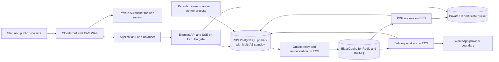

# CertiFlow production deployment plan

This plan describes the production target. The local Compose workflow runs approval, automatic review escalation, scoped staff SSE, PostgreSQL outbox dispatch, private PDF issuance, mock delivery, public verification, and revocation. Local certificates use a single-host Docker volume and the mock provider uses PostgreSQL for its receipt ledger. The sizing figures are starting assumptions to verify with load and failure tests.

## Design load

- 100,000 registered users and around 10,000 daily active users.
- 500 batch approvals in a peak hour, producing roughly 30,000 PDFs and 30,000 WhatsApp sends. Each stage averages 8.3 jobs per second during that hour.
- Thousands of daily public verifications, including bursts. Verification must reflect a committed revocation immediately.

## Architecture and hosting

Use CloudFront and a private S3 origin for the static Vite build. Route API and SSE traffic to the ALB with caching disabled. Apply WAF rate limits to login and anonymous verification. Deploy the Express API and worker roles on ECS Fargate in two Availability Zones. Start with two API tasks and scale the worker pools independently from the API using queue age and database pressure. Run schema migrations as a one-off ECS task with a migration role before replacing the service tasks.

Use RDS PostgreSQL Multi-AZ for managed failover and point-in-time recovery. Read public verification from the primary using the unique certificate number. Disable CDN, HTTP and application caching for verification responses. Use managed Redis privately with failover and a no-eviction policy for BullMQ. Cache non-authoritative lookups separately if measurements justify it. Store credentials in Secrets Manager, require TLS, and grant task roles access to the secrets and storage paths their processes use. Give PostgreSQL writer roles narrowly scoped table privileges and restrict alteration or deletion of audit history.

## Throughput and backlogs

- The API will commit final approval, audit history, and a uniquely keyed outbox record in one transaction. It returns once PostgreSQL commits. Done state lives in PostgreSQL, and stable BullMQ job IDs allow replay and deduplication. Dispatch in small chunks to avoid creating tens of thousands of jobs or database connections at once.
- Target 15 PDFs per second for headroom. If a measured render consumes 250 ms of CPU, eight effective vCPUs at 50% utilization give about 16 PDFs per second. Budget for render memory and consume the CPU-heavy work in processes that can use the available cores. Verify with actual templates and files.
- Target 15 accepted provider requests per second where the configured quota permits. Constrain concurrency, apply a shared queue rate limit, and pace retries using provider feedback. At 15 per second a 30,000-message backlog takes about 33 minutes to drain after arrivals stop. With 8.3 arrivals per second during the peak, the same backlog takes about 75 minutes to drain.
- Cap connections per API and worker task. Scale down if the database pool or lock wait becomes the bottleneck and consider a managed connection proxy as concurrency grows. Keep transactions short and external calls out of them.
- Each Express instance reads transactional PostgreSQL versions once per second while streams are open. One query rechecks the active sessions and their current centre, district, role and user scopes. SSE carries view names only, and every reconnect refetches authorized persisted state. Keep proxy buffering and caching disabled and the idle timeout longer than the 15-second heartbeat. At the target load, measure hot-counter lock waits and dashboard refetch traffic. If bounded polling becomes a bottleneck, add a best-effort wake-up channel and keep the database snapshot for reconciliation.

## Failure handling

| Failure | Recovery |
| --- | --- |
| Worker crash | BullMQ recovers stalled work. Retry using persisted state, unique certificate numbers and candidate IDs, deterministic private object keys, and delivery idempotency keys. Complete the outbox event after its durable effects finish. |
| Redis restart or data loss | Scan PostgreSQL for unfinished events and re-enqueue them with stable keys. Recover failed or missing jobs explicitly. Redis durability reduces recovery lag. The API commits approvals while the queue is unavailable. |
| WhatsApp errors, timeouts, or outage | Persist attempts and receipts. Back off with jitter, honoring quota responses. After an ambiguous timeout retry with the same provider key or query the provider’s receipt. Exactly-once acceptance depends on provider deduplication or receipt lookup. The mock should persist deduplication across restarts and simulate a timeout after acceptance. |
| Slow database or failover | Bound connection and statement timeouts, pause worker pulls as saturation increases, and propagate readiness failures. Retry only safe operations based on idempotency keys. Keep verification unavailable during loss of the authoritative read path. |
| Delayed review | The worker scans indexed review timestamps on startup and once per minute. It uses PostgreSQL row locks and a unique revision and stage key to persist one escalation, audit event and per-state-officer notification. Redis is outside the scan path. |

## Certificate storage and access

Keep the S3 certificate bucket private with block-public-access, encryption, versioning, and tightly scoped IAM roles. Use a separate bucket from web assets. The message contains an expiring, high-entropy link scoped to one certificate. Store a digest of the link token, verify the current certificate and access grant on every download, and stream the object through an authorized endpoint with `Cache-Control: private, no-store`. Public verification returns a minimal status response with expressly allowed fields and no contact information or file access. Enforce a retention schedule for historical snapshots, download grants, and logs.

## Monitoring

Track request latency and 5xx rates, database connection pressure and lock waits, replication/failover health, oldest unfinished outbox event, queue backlog and age, PDF runtime and failure rate, provider acceptance and timeouts, and overdue reviews and escalation latency. Log request, batch revision, certificate and event IDs across services. Omit phone numbers, session tokens, download grants, and provider payloads from logs. Start with paging thresholds of 1% API 5xx over 5 minutes, 80% database connection utilization sustained for 10 minutes, and a 15-minute-old issuance backlog during results hours. Tune after load testing and set up a recurring backup restore drill.

## Rough monthly cost

Planning ranges in USD for AWS US East (N. Virginia), on-demand, about 730 hours, two Availability Zones, and occasional results-day burst capacity. Amounts are estimates based on the listed service categories and require a region-specific quote.

| Component | Assumed shape | USD/month |
| --- | --- | ---: |
| ECS Fargate | Two API tasks and two worker tasks at 1 vCPU/2 GiB each, plus short peak scaling | $145–$180 |
| RDS PostgreSQL | Multi-AZ general-purpose instance, 100 GiB storage and backups | $110–$175 |
| ElastiCache | Small Redis primary and replica | $45–$75 |
| Networking and edge | ALB, CloudFront, WAF, and private egress or endpoints | $60–$120 |
| S3, logs and metrics | About 50 GiB of files plus limited log retention and moderate egress | $15–$45 |
| **Total** | Infrastructure only | **$375–$595** |

Managed failover raises the baseline and simplifies recovery. Timed worker scaling controls compute cost. At 250 kB per PDF, 8,000 PDFs add about 2 GB of files per month before versioning and retention. A real messaging provider’s country-specific delivery charges, taxes, and unusual traffic spikes need their own estimate. [AWS Fargate pricing](https://aws.amazon.com/fargate/pricing/) · [RDS PostgreSQL pricing](https://aws.amazon.com/rds/postgresql/pricing/) · [ElastiCache pricing](https://aws.amazon.com/elasticache/pricing/) · [S3 pricing](https://aws.amazon.com/s3/pricing/) · [AWS Pricing Calculator](https://calculator.aws/)
